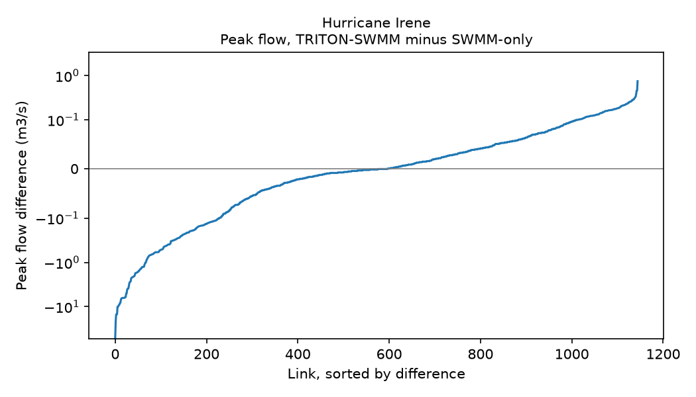
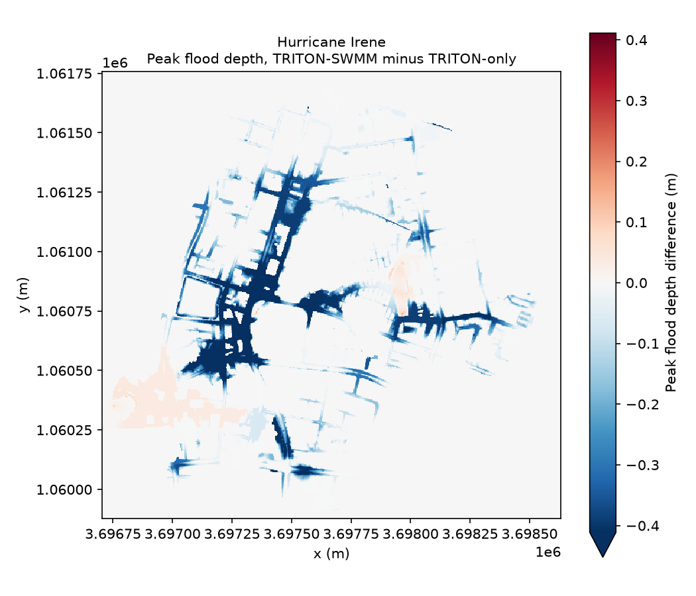

# Exploratory analysis of an event ensemble

## Run the step

The step starts from an analysis that has completed and consolidated. The tutorial runs the step on the observed-event ensemble of [Simulating an event ensemble](norfolk-observed-events.md).

```bash
hhemt eda --analysis-dir {analysis_dir}
```

The command runs in process on the calling machine, with no allocation, no simulation, and no consolidation. Every path written lands under the analysis directory.

| Path | Content |
|---|---|
| `eda.ipynb` | The seeded notebook |
| `eda_report/eda_report.html` | The executed and converted notebook |
| `eda/raw_byte_identity.verdict.json` | The verdict of the byte-identity check |
| `eda_local/` | A package for your own EDA code |
| `cfg_analysis.yaml`, `cfg_system.yaml` | The system and analysis configs as the notebook reads them |

A copied analysis directory can print a line that the validation report could not be persisted again, because a relative DEM path resolves in the original directory only. The step finishes with that line, and the files above are written. [Run the exploratory analysis](../how-to/running-eda.md) covers the options of the command.

## The seeded notebook

[Download the notebook the step wrote for this ensemble](assets/eda.ipynb). Each invocation writes a new notebook named `eda.ipynb`, then `eda_1.ipynb`, and so on, and leaves an existing notebook untouched. Work written in an earlier notebook survives, and the newest file carries the refreshed seed cells.

The first code cell binds `ctx`, the experiment that the toolkit re-derives from the persisted configs.

```python
from pathlib import Path

from hhemt.eda import load_eda_context, render_eda_plots

root = Path.cwd()
ctx = load_eda_context(root)
ctx.is_bundle, ctx.cfg_analysis.analysis_id
```

The inventory cell lists the fields of the object bound to `ctx`. For this ensemble `datatree` and `performance` hold an `xarray.DataTree`, `scenario_status` holds a `DataFrame`, and `sensitivity_datatree`, `swmm_features` and `triton_dem` hold `None`, because the analysis carries no such artifact. The cell of seed figures reports `no EDA figures for this experiment`, because the figures of the step compare the members of a sweep and an event ensemble has none.

The notebook is the source of truth. The cells call the installed functions of the toolkit and re-derive their variables on execution, so the notebook keeps working inside a render bundle. The HTML export in `eda_report/` is a convenience. A missing kernel, a cell error, or a timeout turns the export into a warning and leaves the notebook in place.

## The byte-identity verdict

The step writes a verdict for the byte-identity check as JSON that follows `analysis_validation.CheckResult`.

```python
import json
from pathlib import Path

verdict = json.loads(Path("{analysis_dir}/eda/raw_byte_identity.verdict.json").read_text())
verdict["passed"], verdict["applicable"], verdict["instrument"]
```

For this ensemble the verdict reads `passed` false, `applicable` true and `instrument` `raw_rasters`, and the summary reads degraded, because the raw outputs are cleared. The check compares raw rasters, so a comparison needs an analysis that keeps them.

## Difference plots for Hurricane Irene

The notebook is the place to author further cells. The committed result `assets/irene-example-result.zarr` holds the groups that the plots read, trimmed to the variables they use, for the Hurricane Irene event. The groups `tritonswmm`, `triton_only` and `swmm_only` hold the coupled model, TRITON, and SWMM. In the notebook, `ctx.datatree` is the `DataTree` of the analysis. The cell below opens the committed copy, so the plots reproduce without the analysis directory.

```python
from pathlib import Path

import matplotlib.pyplot as plt
import xarray as xr

store = Path("assets/irene-example-result.zarr")
tree = xr.open_datatree(store, engine="zarr", consolidated=False)
```

### Peak flow difference

The first plot subtracts the peak flow of each link in the SWMM-only simulation from the peak flow of the same link in the TRITON-SWMM simulation. The groups hold different link sets, so the subtraction aligns on `link_id` and keeps the links that both groups hold. The vertical axis is linear within 0.1 m3/s of zero and logarithmic beyond. Negative values mark links where the coupled simulation records the lower peak flow.

```python
flow_coupled = tree["tritonswmm/swmm_link"].to_dataset()["max_flow"].isel(event_iloc=0)
flow_swmm = tree["swmm_only/swmm_link"].to_dataset()["max_flow"].isel(event_iloc=0)
flow_coupled, flow_swmm = xr.align(flow_coupled, flow_swmm, join="inner")
flow_difference = flow_coupled - flow_swmm
flow_difference = flow_difference.sortby(flow_difference)

fig, ax = plt.subplots(figsize=(7, 4))
ax.plot(range(flow_difference.sizes["link_id"]), flow_difference.values)
ax.axhline(0, color="grey", linewidth=0.8)
ax.set_yscale("symlog", linthresh=0.1)
ax.set_xlabel("Link, sorted by difference")
ax.set_ylabel("Peak flow difference (m3/s)")
ax.set_title("Hurricane Irene\nPeak flow, TRITON-SWMM minus SWMM-only", fontsize=10)
fig.tight_layout()
fig.savefig("assets/eda-peak-flow-difference.png", dpi=150)
```



The source is the group `swmm_link` of `tritonswmm` and of `swmm_only` in `assets/irene-example-result.zarr`.

### Peak flood depth difference

The second plot subtracts the peak depth of each cell in the TRITON-only simulation from the peak depth of the same cell in the TRITON-SWMM simulation. Both simulations share the grid, so the subtraction needs no alignment. The variable `max_flood_depth` holds the depth of water above the ground and reads 0 in dry cells. Blue marks cells where the coupled simulation records the lower peak depth. The color range is symmetric about zero and clips at the 2nd and 98th percentiles of the differences, so a cell beyond the range takes the end color.

```python
depth_coupled = tree["tritonswmm/triton"].to_dataset()["max_flood_depth"].isel(event_iloc=0)
depth_triton = tree["triton_only/triton"].to_dataset()["max_flood_depth"].isel(event_iloc=0)
depth_difference = depth_coupled - depth_triton

fig, ax = plt.subplots(figsize=(7, 6))
depth_difference.plot(
    ax=ax,
    cmap="RdBu_r",
    center=0,
    robust=True,
    cbar_kwargs={"label": "Peak flood depth difference (m)"},
)
ax.set_aspect("equal")
ax.set_xlabel("x (m)")
ax.set_ylabel("y (m)")
ax.set_title("Hurricane Irene\nPeak flood depth, TRITON-SWMM minus TRITON-only", fontsize=10)
fig.tight_layout()
fig.savefig("assets/eda-peak-flood-depth-difference.png", dpi=150)
```



The source is the group `triton` of `tritonswmm` and of `triton_only` in `assets/irene-example-result.zarr`.

## Calculation and figure

Each member of the step has a calculation half and a figure half that fail independently. The calculation reads the analysis, writes a backing dataset under `eda/`, and returns a verdict. The verdict merges into `validation_report.json` and appears under Errors and Warnings in the report. The figure reads the backing dataset only. A calculation that finds no applicable data writes no dataset and records a not-applicable verdict, and the figure is skipped, so a missing result never appears as an empty figure.

The step writes figures to `plots/eda/` for each calculation that wrote a backing dataset, and an event ensemble has none. A [reporting set](../reference/reporting-sets.md) decides whether `analysis_report.html` shows them. The sets `compute_sensitivity`, `dem_resolution` and `compute_config_byte_identity` carry the exploratory adapter, and [Sensitivity-analysis sets](../reference/reporting-sets.md#sensitivity-analysis-sets) states the result of selecting one for an analysis of another shape.

A verdict reports whether the comparison found a difference and the size of the difference at a stated detection floor. The reader decides whether that difference matters. [`hhemt combine`](../how-to/combining-experiments.md) compares finished experiments with each other.

## Next steps

- [Run the exploratory analysis](../how-to/running-eda.md) lists the commands, the outputs, and the choice of figures.
- [Reporting sets](../reference/reporting-sets.md) lists the renderer bundles that carry exploratory figures into the report.
- [The interactive analysis report](../reference/example-report.md) lists the sections of the main report.
