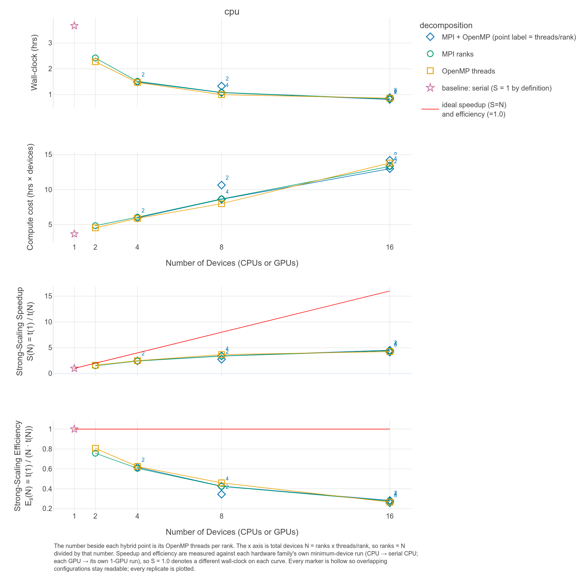

# Running a benchmarking experiment

## Key result

[Read the full benchmarking report](../reference/bundles/norfolk-compute-config-sweep-report.html). The **Benchmarking** page of the report holds the figure below, drawn against total devices.



## The experiment

A **compute configuration** sets the number of MPI ranks, the number of OpenMP threads per rank and the number of nodes that one simulation uses. The experiment compares compute configurations for one storm, Hurricane Irene, on the 3.5 m grid of the Norfolk case study with the coupled TRITON-SWMM model only. [The events](norfolk-observed-events.md#the-events) gives the simulation window. Every simulation runs natively on one node of a CPU partition of a university cluster. The compute configuration is the only designed difference between simulations. [Limits of the evidence](#limits-of-the-evidence) names the other differences.

## The decision

**Give each simulation 8 cores.** Within the 8-core options the sweep tried, 8 OpenMP threads on one rank finished fastest and the 4 rank by 2 thread hybrid finished slowest. Past 8 cores the sweep shows sharply diminishing returns.

The evidence comes from the table in [The evidence](#the-evidence).

- **Each doubling of cores up to 8 cut the wall-clock time by 32 to 38 percent.** Taking the fastest configuration at each core count, the speedup per doubling is 1.61 from 1 to 2 cores, 1.55 from 2 to 4, and 1.47 from 4 to 8.
- **The doubling from 8 to 16 cores cut the wall-clock time by 18.7 percent.** The fastest 8-core simulation took 0.999 hours and the fastest 16-core simulation took 0.812 hours, a speedup of 1.23 for 62.5 percent more core-hours at 8.00 and 13.00.
- **Efficiency falls from 0.62 at 4 cores to 0.46 at 8 and 0.28 at 16.** Efficiency is the speedup divided by the core count, so 0.46 means 8 cores did the work of 3.7.
- **At 8 cores one split is an outlier.** Most 8-core splits finished between 0.999 and 1.084 hours. OpenMP took 0.999, the 2 by 4 hybrid 1.077 and MPI 1.084. The 4 rank by 2 thread hybrid took 1.331 hours, 33 percent longer than OpenMP, in a single simulation. The same 2-thread hybrid shape is the fastest 16-core row at 8 by 2 and 0.812 hours, so the pattern repeats at no other core count and the table supports no general rule about splits. [Simulating an event ensemble](norfolk-observed-events.md) used the 4 by 2 split.
- **At 4 cores the split matters little.** The 4-core splits finished within about 3 percent of each other, from 1.472 to 1.516 hours.

The table supports a reading and a judgment. The reading is that the knee of the curve, where the return on added cores drops fastest, falls at 8 cores. The judgment depends on the ensemble. An ensemble with more simulations than the cores can run at once takes a total time set by total core-hours, and at 8 cores each simulation costs 8.00 core-hours against 13.00 at 16. An ensemble with few simulations that each need to finish as soon as possible runs faster at 16 cores, and the table prices that choice.

## The sweep

The experiment is a [benchmarking](../reference/glossary.md#benchmarking) analysis. Every spreadsheet row is one [member](../reference/glossary.md#member), an analysis of the same model under a different compute configuration. The rows hold every combination of MPI ranks and OpenMP threads on one node whose product is at most 16 and that the full CPU sweep contains.

```text
member_id,analysis.run_mode,analysis.n_nodes,analysis.n_mpi_procs,analysis.n_omp_threads,analysis.n_gpus,analysis.mem_gb_per_cpu,analysis.hpc_time_min_per_sim
32,serial,1,1,1,0,2,720
26,openmp,1,1,2,0,2,360
27,openmp,1,1,4,0,2,360
28,openmp,1,1,8,0,2,360
29,openmp,1,1,16,0,2,360
22,mpi,1,2,1,0,2,360
23,mpi,1,4,1,0,2,360
24,mpi,1,8,1,0,2,360
25,mpi,1,16,1,0,2,360
4,hybrid,1,2,2,0,2,360
5,hybrid,1,2,4,0,2,360
6,hybrid,1,4,2,0,2,360
7,hybrid,1,2,8,0,2,360
8,hybrid,1,4,4,0,2,360
9,hybrid,1,8,2,0,2,360
```

The loader reads a column in one of the forms below and refuses any column in another form, naming the offending columns and the accepted forms.

| Column form | Example | Meaning |
|---|---|---|
| `member_id` | `c_mpi4` | Required, unique, and safe as a filename fragment. Values match `^[A-Za-z0-9_.]+$`. |
| `analysis.{field}` | `analysis.n_mpi_procs` | The canonical form for an analysis-config field. Overrides that field for the member. |
| `system.{field}` | `system.target_dem_resolution` | Overlays that system-config field for the member. |
| `system_config_yaml` | `systems/uva_two_node.yaml` | A whole system config for the member, by path. Excludes `system.*` columns on the same row. |
| `hpc.partition` or `hpc.setup_partition` | `hpc.partition` | Aliases that set the partition selectors per row, so a sweep can cross partitions and the GPU hardware that comes with them when members run as separate jobs. |
| A bare analysis-config field name | `run_mode` | Refused. The loader raises a `ConfigurationError` that lists the bare names and the `analysis.{field}` form to rename each header cell to, and the values stay in place. |

A blank cell means the member inherits the value from the analysis config, so a sheet names only the fields that differ between rows. The sweep refuses an `hpc.gpu_hardware` column because the partition of a row sets the GPU hardware. [Choose a partition](../how-to/hpc-profile-setup.md#choose-a-partition) covers the partition choice.

!!! warning "Start from the sheet on this page"
    The spreadsheets under `test_data/norfolk_coastal_flooding/` hold the annotation columns `device`, `total_MPI_ranks`, and `selected`, notes for a human reader that the sweep loader refuses. Copy the config-field columns out of them, or write a sheet from the tables on this page.

The analysis config turns the sweep on, points at the sheet, selects the single Irene event, and selects the `benchmarking` reporting set.

```yaml
toggle_sensitivity_analysis: true
sensitivity_analysis: compute_config_sweep.csv
weather_events_to_simulate: irene_event_index.csv
run_mode: serial
multi_sim_run_method: batch_job
execution_environment: native
report:
  reporting_set: benchmarking
```

A sensitivity analysis runs the coupled TRITON-SWMM model alone, so the system config enables that model family only. The remaining fields come from the Norfolk templates `test_data/norfolk_coastal_flooding/template_system_config.yaml` and `template_analysis_config.yaml`. Fill the placeholders they carry, following [Config filling](../how-to/config-filling.md#4-point-the-analysis-config-at-your-events).

Keep one `serial` member in every sweep. The scaling panels normalize each series against the quickest member at the smallest device count, so the `serial` member anchors the speedup.

## Run the experiment

Install the toolkit and compile the solver first by following [Installation](../how-to/installation.md) and [Compile the solver](../how-to/compiling-the-solver.md#on-a-cluster). A cluster needs both on the machine that submits the jobs. Author an HPC profile for the cluster with [HPC-profile setup](../how-to/hpc-profile-setup.md). A workstation without a scheduler follows [A pair of members on one machine](#a-pair-of-members-on-one-machine).

The dry run of [Config filling step 6](../how-to/config-filling.md#6-verify-before-you-commit-compute) validates every member before anything is submitted.

```bash
hhemt run --system-config my_system.yaml --analysis-config compute_config_sweep.yaml \
    --hpc-system-config hpc_system_config_uva.yaml --dry-run
hhemt run --system-config my_system.yaml --analysis-config compute_config_sweep.yaml \
    --hpc-system-config hpc_system_config_uva.yaml
```

The command creates one analysis directory per member under `members/member_{member_id}/` and one report for the experiment. Edit the spreadsheet and leave the derived `sensitivity_analysis_definition.csv` alone, as [Rerun triggers](../reference/rerun-triggers.md) explains.

The last step of the experiment renders `analysis_report.html` in the analysis directory with every figure inlined, so the file opens with no server and no unzip step.

## A pair of members on one machine

A sweep of a pair of members needs no scheduler. One member runs the model on a single process, and the other sets `analysis.n_omp_threads` to 2. The pair exercises the member directories, the per-member config overlay, and a report that puts the members side by side on wall-clock and compute cost.

| `member_id` | `analysis.run_mode` | `analysis.n_omp_threads` |
|---|---|---|
| `m_serial` | `serial` | |
| `m_omp2` | `openmp` | `2` |

```yaml
analysis_id: benchmarking_local
toggle_sensitivity_analysis: true
sensitivity_analysis: sweeps/benchmarking_local.xlsx
multi_sim_run_method: local
local_cpu_cores_for_workflow: 4
report:
  reporting_set: benchmarking
```

`multi_sim_run_method: local` keeps the members on the machine, and the [glossary](../reference/glossary.md#multi_sim_run_method) defines the other dispatch values. Size `local_cpu_cores_for_workflow` to the cores to commit, because the setting bounds the pool of the workflow.

## The evidence

The wall-clock figure is the solver's reported total time for the simulation, `performance.Total` taken as the slowest rank, in hours. Core-hours are the wall-clock hours times the cores. Speedup is the serial wall-clock divided by the wall-clock of the configuration, and efficiency is the speedup divided by the cores. Each row is one simulation.

| Cores | Member | Ranks x threads | Mode | Wall-clock hours | Core-hours | Speedup | Efficiency | Source simulation |
|---:|---:|---|---|---:|---:|---:|---:|---|
| 1 | 32 | 1 x 1 | serial | 3.672 | 3.67 | 1.00 | 1.00 | reused |
| 2 | 26 | 1 x 2 | openmp | 2.277 | 4.55 | 1.61 | 0.81 | final job |
| 2 | 22 | 2 x 1 | mpi | 2.424 | 4.85 | 1.51 | 0.76 | final job |
| 4 | 27 | 1 x 4 | openmp | 1.472 | 5.89 | 2.50 | 0.62 | final job |
| 4 | 4 | 2 x 2 | hybrid | 1.492 | 5.97 | 2.46 | 0.62 | final job |
| 4 | 23 | 4 x 1 | mpi | 1.516 | 6.07 | 2.42 | 0.61 | final job |
| 8 | 28 | 1 x 8 | openmp | 0.999 | 8.00 | 3.67 | 0.46 | reused |
| 8 | 5 | 2 x 4 | hybrid | 1.077 | 8.62 | 3.41 | 0.43 | reused |
| 8 | 24 | 8 x 1 | mpi | 1.084 | 8.67 | 3.39 | 0.42 | reused |
| 8 | 6 | 4 x 2 | hybrid | 1.331 | 10.65 | 2.76 | 0.34 | reused |
| 16 | 9 | 8 x 2 | hybrid | 0.812 | 13.00 | 4.52 | 0.28 | final job |
| 16 | 25 | 16 x 1 | mpi | 0.832 | 13.32 | 4.41 | 0.28 | final job |
| 16 | 8 | 4 x 4 | hybrid | 0.837 | 13.39 | 4.39 | 0.27 | final job |
| 16 | 29 | 1 x 16 | openmp | 0.863 | 13.80 | 4.26 | 0.27 | final job |
| 16 | 7 | 2 x 8 | hybrid | 0.888 | 14.21 | 4.14 | 0.26 | final job |

Rows are ordered by cores, then by wall-clock. The report draws the same numbers as panels of wall-clock, compute cost, speedup, and efficiency against the number of devices, MPI ranks, and OpenMP threads. Open **Benchmarking** under **Key Results** in the sidebar for one figure per x axis. **Per Simulation Results** holds the peak flood depth and conduit flow of each member.

Compare members within one experiment and across experiments with care, because each number reflects the domain, the build, and the partition. Speedup divides by the quickest member at the smallest device count, so a member at that end with a missing or badly timed result makes the speedup panels mislead. Keep one GPU hardware family within an experiment, because hardware is an axis of the figures.

## Limits of the evidence

- **Members 5, 6, 24, 28, and 32 were reused from an earlier job.** The toolkit reused them because their inputs had not changed. The report presents all members as one sweep. The reused members include the serial baseline that every speedup divides by and every 8-core row. The 8-core rows agree with each other, and the comparison between 8 cores and either 4 or 16 crosses a job boundary.
- **Each configuration ran once.** The table holds a single simulation per row, so the variation in wall-clock between repeats of one configuration is unmeasured. The 4-core rows differ by 3 percent, and a difference that small is weak evidence for a better split.
- **One storm, one grid, one machine.** The decision holds for this model at 3.5 m on this partition. The sweep stops at 16 cores per simulation and reports no returns beyond 16.
- **The job count on the Workflow Performance page can omit the workflow run that rendered the report.** A report rendered inside a workflow run leaves that workflow run out, because the jobs of that workflow run were still running when the page was built, and the page names the omitted workflow run. A report rendered later, from the analysis directory, counts every job.
- **The sweep documents the method and is no publishable benchmark.** A published claim needs replicates and the full range of core counts.

## GPU count on one node

The same sweep on a GPU partition holds one CPU baseline and members at 1, 2, and 4 GPUs. The CPU row anchors the speedup of the GPU rows and shows where a GPU is worth the queue time for the model at the domain size.

| `member_id` | `analysis.run_mode` | `analysis.n_gpus` | `analysis.n_mpi_procs` | `hpc.partition` |
|---|---|---|---|---|
| `g_cpu1` | `serial` | | | `standard` |
| `g_gpu1` | `gpu` | `1` | `1` | `gpu-a6000` |
| `g_gpu2` | `gpu` | `2` | `2` | `gpu-a6000` |
| `g_gpu4` | `gpu` | `4` | `4` | `gpu-a6000` |

```yaml
analysis_id: benchmarking_gpu
toggle_sensitivity_analysis: true
sensitivity_analysis: sweeps/benchmarking_gpu.xlsx
multi_sim_run_method: batch_job
hpc_total_job_duration_min: 180
hpc_time_min_per_sim: 90
hpc_ensemble_partition: standard
hpc_setup_and_analysis_processing_partition: standard
report:
  reporting_set: benchmarking
```

The `hpc.partition` column makes the experiment mixed. Each row names the partition of the member, so the CPU row stays off the GPU partition, where a job without a GPU is refused. The partition names come from the shipped UVA profile. Substitute the names of your own profile, and on a cluster with a single partition use that name on every row. GPU members need a solver built for the GPU partition, so an experiment on both partitions builds a target for each. [Compile the solver](../how-to/compiling-the-solver.md#on-a-cluster) states the build requirements. GPU scaling depends on the domain size, so a member without a speedup at a small grid is a measurement and no defect.

## The same experiment on a second machine

The members of the second-machine sheet span both axes, and the sheet runs under the HPC profile of each machine.

| `member_id` | `analysis.run_mode` | `analysis.n_omp_threads` | `analysis.n_mpi_procs` | `analysis.n_gpus` | `hpc.partition` |
|---|---|---|---|---|---|
| `x_serial` | `serial` | | | | `gpu-a6000` |
| `x_omp2` | `openmp` | `2` | | | `gpu-a6000` |
| `x_mpi2` | `mpi` | `1` | `2` | | `gpu-a6000` |
| `x_gpu1` | `gpu` | | `1` | `1` | `gpu-a6000` |
| `x_gpu2` | `gpu` | | `2` | `2` | `gpu-a6000` |

```yaml
analysis_id: benchmarking_second_machine
toggle_sensitivity_analysis: true
sensitivity_analysis: sweeps/benchmarking_second_machine.xlsx
multi_sim_run_method: 1_job_many_srun_tasks
hpc_total_nodes: 1
hpc_total_job_duration_min: 300
hpc_ensemble_partition: gpu-a6000
hpc_setup_and_analysis_processing_partition: standard
report:
  reporting_set: benchmarking
```

All members run inside one allocation, and `hpc_ensemble_partition` is the `#SBATCH --partition` of that allocation. Every row therefore names the same partition. The partition is `gpu-a6000` here because the experiment includes GPU members, and an allocation on a partition without GPUs leaves the members no GPU to bind. On a second machine, the selector fields, the cluster profile, and the partition name in every row change together. On the shipped AMD-GPU profile all of them take `batch`, because that cluster has a single partition. Members on different partitions need the `batch_job` dispatch of the previous section, and that dispatch submits a job per member.

Run the experiment once per machine under that machine's HPC profile, with a different `analysis_id` each time. A per-machine report compares members within one machine, and combining the experiments produces the cross-machine comparison.

```bash
# once per machine, shown for the AMD-GPU cluster
hhemt bundle --system-config my_system.yaml --analysis-config bench_second.yaml \
    --hpc-system-config hpc_system_config_frontier.yaml
```

The bundle command writes a zip under `render_bundle/` in the analysis directory. The combine command accepts the zips as they are, with no unzip step.

```bash
hhemt combine benchmarking_second_amd/render_bundle/*.zip \
    benchmarking_second_uva/render_bundle/*.zip -o combined
```

[Combining experiments](../how-to/combining-experiments.md) covers the arguments, the default output path and the severity table. The combined report opens on the compatibility check between the experiments before any figure. The differences that check reports between the compute configurations of the machines decide how far the cross-machine figures can be read.

## Next steps

- [Reporting sets](../reference/reporting-sets.md) lists the renderers that `benchmarking` bundles and the steps to add the compute-sensitivity figures.
- [Running a synthetic compute-sensitivity experiment](../how-to/synthetic-compute-sensitivity-experiment.md) runs the same experiment on a generated model, for characterizing a cluster without staged case-study data.
- [Configuration schema](../reference/config-schema.md) lists every field in the blocks above and the fields each dispatch mode adds.
- [Running a simulation interactively in Python](interactive-python.ipynb) lists the compute configurations and the dispatch calls.
