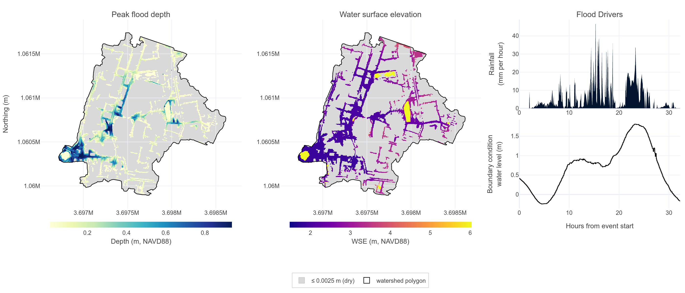

# Simulating an event ensemble

## Key result

[Read the full report](../reference/bundles/norfolk-observed-events-report.html). The figure is the TRITON-SWMM result for Hurricane Irene from the **Per Simulation Results** pages of that report.



## The ensemble

An **observed-event ensemble** simulates storms that happened, driven by the measured rainfall and water level of each storm. The ensemble simulates the observed events on the Norfolk, VA case study at a 3.5 m grid, each with the TRITON-SWMM, TRITON, and SWMM models. The status export lists a row per event and model. The ensemble demonstrates the output and gives no hazard estimate for the storms.

The ensemble ran natively without a container on a CPU partition of a university cluster, with every simulation on one node. Any machine with the compiled solver runs the same definition, and only the dispatch fields of the analysis config change.

## The events

The events come from a subset of the observed-event index, the table of every storm in the weather record. The subset file lists the rows that the ensemble simulates. Each event has a named storm and a public source for that attribution. The sources establish the storm and the place, and the event index sets the simulation window.

| Event | Simulation window | Event type | Public source |
|---|---|---|---|
| Hurricane Isabel | 2003-09-17 05:44 to 2003-09-19 07:34 | compound | [13newsnow.com, 18 September 2024](https://www.13newsnow.com/article/weather/knowledge/a-look-back-at-hurricane-isabel/291-caff2aad-2152-481d-9cd5-0e09120afc04) |
| Mid-Atlantic nor'easter of November 2009, the remnant of Hurricane Ida | 2009-11-11 07:10 to 2009-11-14 05:36 | compound | [weather.gov event review](https://www.weather.gov/mhx/nov132009eventreview) |
| Hurricane Irene | 2011-08-27 00:44 to 2011-08-28 08:58 | compound | [pilotonline.com, 28 August 2011](https://www.pilotonline.com/2011/08/28/storm-surge-from-hurricane-irene-falls-short-of-predictions-2/) |
| Hurricane Hermine, post-tropical at the time of the Virginia flooding | 2016-09-02 20:44 to 2016-09-04 16:32 | compound | [mashable.com, 3 September 2016](https://mashable.com/article/hermine-virginia-flooding) |
| Hurricane Matthew | 2016-10-08 08:04 to 2016-10-09 18:12 | compound | [nnva.gov storm surge page](https://www.nnva.gov/3052/Storm-Surge) |
| Hurricane Dorian | 2019-09-06 07:46 to 2019-09-07 04:54 | surge | [pilotonline.com, 6 September 2019](https://www.pilotonline.com/2019/09/06/hampton-roads-ducked-the-worst-of-hurricane-dorian/) |

The event type is the classification of the observed-event index. All events are compound except the last, a surge event. The rows follow date order, the order of the event pages of the report. The report labels each event from the event index, so read the attribution and source of each event from the table. The Isabel source covers the storm, the place in Hampton Roads, and the year. The Hermine source covers the storm, the place, and the days inside the simulation window on Friday 2 and Saturday 3 September 2016. Neither source gives the bounds of the window.

## The config

The ensemble takes a [system](../reference/glossary.md#system) config and an [analysis](../reference/glossary.md#analysis) config. The system config turns on the TRITON, TRITON-SWMM, and SWMM model families.

```yaml
toggle_triton_model: true
toggle_tritonswmm_model: true
toggle_swmm_model: true
target_dem_resolution: 3.5
```

The analysis config names the weather record, the event windows, and the subset of events to simulate, and sets how each simulation uses the machine.

```yaml
weather_events_to_simulate: observed_events_named_subset.csv
toggle_sensitivity_analysis: false
run_mode: hybrid
n_mpi_procs: 4
n_omp_threads: 2
n_nodes: 1
multi_sim_run_method: batch_job
execution_environment: native
```

`run_mode: hybrid` with 4 MPI ranks of 2 OpenMP threads gives each simulation 8 cores on one node, and `multi_sim_run_method: batch_job` submits each simulation as a separate job. The ensemble used the 4 rank by 2 thread split, and the split carries no recommendation. The [compute-configuration sweep](norfolk-compute-config-sweep.md) ranks that split last among the 8-core splits the sweep tried, at 1.331 hours against 0.999 for 8 OpenMP threads in a single simulation each. The subset file is a table with a row per event and the following columns.

```text
year,event_type,event_id,event_start,event_end,description,event_label
```

The first columns, `year`, `event_type`, and `event_id`, form the key of the event in the observed-event index. The subset selects rows by key and restates no rainfall or water level of a storm. Fill the remaining fields of both configs from the Norfolk templates, as [The sweep](norfolk-compute-config-sweep.md#the-sweep) describes, and see [Config filling](../how-to/config-filling.md) for the fields this page leaves out.

## Run the ensemble

Install the toolkit with [Installation](../how-to/installation.md), compile the solver with [Compile the solver](../how-to/compiling-the-solver.md), and complete the [Quickstart](../quickstart.md) to put the Norfolk example data on disk.

Validate the configs with a dry run first, as [Config filling step 6](../how-to/config-filling.md#6-verify-before-you-commit-compute) describes.

```bash
hhemt run --system-config my_system.yaml --analysis-config observed_events.yaml --dry-run
hhemt run --system-config my_system.yaml --analysis-config observed_events.yaml
```

On a cluster, add the HPC profile as [Run the experiment](norfolk-compute-config-sweep.md#run-the-experiment) shows. The command simulates every scenario, then processes the outputs, consolidates them, validates the finished tree, and renders the report.

## Report contents

The sidebar of the report follows the default reporting set, described in [The interactive analysis report](../reference/example-report.md).

- **Errors and Warnings** holds the post-completion validation. Every applicable check passed for the ensemble. The status export carries one row per model family and event.
- **Per Simulation Results** holds one page per event. Each page shows the rainfall and boundary-condition forcing, the peak flood depth from TRITON and from TRITON-SWMM, and the conduit flow from TRITON-SWMM and from SWMM.
- **Workflow Performance** and **Metadata** record the cost of each job and the toolkit build that produced the result.

Comparing the peak-flood-depth panels of one event shows the contribution of the coupled model to the surface-only model. Comparing the conduit-flow panels shows the contribution of the surface water to the pipe network alone.

To embed a report in your own documentation, follow [Embedding a report in your own documentation](../reference/example-report.md#embedding-a-report-in-your-own-documentation). [Running a benchmarking experiment](norfolk-compute-config-sweep.md) chooses a compute configuration for an event ensemble and gives the cost of each split, the 4 rank by 2 thread split of this ensemble included.
